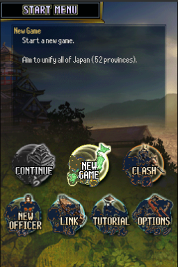
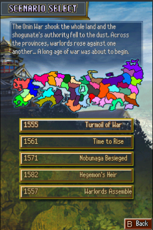
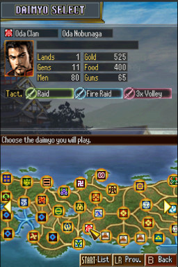
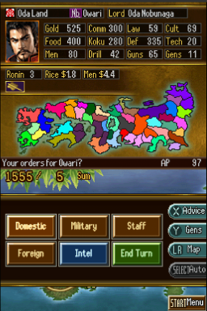
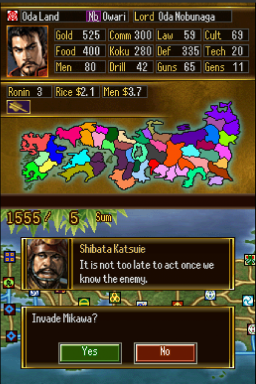
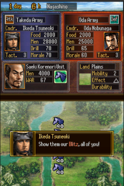
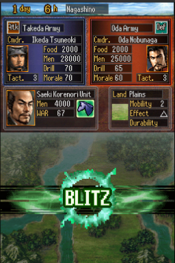
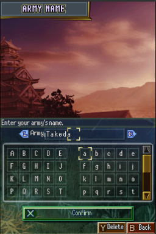
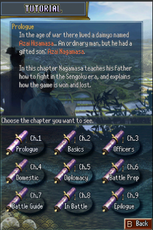

# Nobunaga's Ambition DS 2 — English Translation

A fan translation of **Nobunaga no Yabou DS 2** (信長の野望DS2, Koei), the Nintendo DS
entry in the *Nobunaga's Ambition* series, into English. The game was only released
in Japan.

> **This is a full machine translation.** All of the game's text was translated from
> Japanese by an AI model, not by a human translator, and it has not been
> proofread by a fluent Japanese speaker. Expect occasional mistranslations, awkward
> phrasing and inconsistent terms. Corrections are welcome.

This repository contains the English text and the tools that build the patch.
It does **not** contain the game, any of its data, or the Japanese script — you need
your own copy of the game.

## Screenshots

| | | |
|:-:|:-:|:-:|
|  |  |  |
| Start menu | Scenario select | Daimyo select |
|  |  |  |
| Strategy screen | Advisor dialogue | Battle |
|  |  |  |
| Tactic cut-in | English name entry | Tutorial |

## What's translated

- All story events, dialogue, advisor text, battle messages and officer biographies
- Menus, commands, help (Art of War) and the tutorial
- Officer, province, tactic and tea ware names (romanised from the game's own readings)
- Clash of Warlords mode: stages, battle talk, records
- Graphics: buttons, titles, labels, badges, banners, tactic cut-ins, tutorial
  screenshots and the staff credits, redrawn at build time with an original English font
- A variable-width font with word wrap, so English text is proportional and lines
  break between words
- **English name entry**: new officers and your Clash of Warlords army are named with
  a letter grid (A–Z, a–z, digits and punctuation) instead of the kana/kanji grid

Long names are shortened where the game's boxes are too small (for example
"Surname G." in officer lists, and a few tactic, skill and terrain names); full
names are kept in `tl/names_*.json` (`full` field).

## Applying the patch (players)

1. Download the release zip (`Nobunagas_Ambition_DS_2_English_v<version>.zip`) from the
   Releases page. It contains the patch, `nobunaga_ds_2_en_v<version>.xdelta`.
2. You need an unmodified dump of the Japanese game (game code `CN2J`):

   | | |
   |---|---|
   | Size  | 67,108,864 bytes |
   | CRC32 | `27353579` |
   | MD5   | `a1e65cf85d3ce68ba998af246162025e` |
   | SHA-1 | `be0705a973809dd961c3fe7aba844208cecb29e8` |

3. Apply it with an xdelta tool, e.g. [Delta Patcher](https://github.com/marco-calautti/DeltaPatcher)
   or the command line:

   ```
   xdelta3 -d -s nobunaga_ds_2.nds nobunaga_ds_2_en_v<version>.xdelta nobunaga_ds_2_en.nds
   ```

## Building from source

Requirements: Python 3.10+, `xdelta3` (optional, for the patch file).

```
python -m venv .venv
.venv/bin/pip install -r requirements.txt
cp /path/to/your/dump.nds nobunaga_ds_2.nds       # must match the checksums above
.venv/bin/python tools/setup.py                    # extracts script/ from your ROM, applies tl/
.venv/bin/python tools/build.py                    # writes build/nobunaga_ds_2_en.nds + .xdelta
```

`tools/setup.py` checks the ROM's SHA-1 and generates `script/`, which pairs the
Japanese text from your ROM with the English from `tl/`. `script/` and `build/`
are never committed. Re-run `setup.py` after editing anything in `tl/`.
The build is reproducible: the same ROM and sources give a byte-identical patch.

To make a release package, run `.venv/bin/python tools/package.py 0.9` after building:
it writes `release/<name>_v0.9.zip` with the versioned xdelta patch and a plain-text
README.txt (notice, patching instructions, clean and patched ROM checksums, known
issues, credits). The ROM itself is never packaged.

## Repository layout

| Path | Contents |
|---|---|
| `tl/msgsecNN.txt` | English for each message file, by entry number (`@N`) |
| `tl/arm9.txt` | English for UI strings in the game code, by address |
| `tl/names_*.json` | English officer, province, tactic and tea ware names |
| `tools/build.py` | Builds the patched ROM and the patch |
| `tools/setup.py` | Creates `script/` from your ROM and `tl/` |
| `tools/tl.py` | Validates and word-wraps translations (`apply`, `show`, `stats`) |
| `tools/patch_arm9.py` | Code patches: ASCII font, variable-width text, word wrap, layout fixes |
| `tools/name_entry.py` | Code patch: English name entry |
| `tools/gfx.py`, `gfxtext.py`, `koeipack.py`, `nitrogfx.py` | Redraw English into the game's graphics at build time |
| `tools/font6x12.py`, `boldfont.py` | Original fonts drawn for this project |
| `tools/package.py` | Makes the release zip (patch + README.txt with checksums) |
| `tools/gen/` | Generated tables (speech-style substitutions) |
| `tools/dev/`, `tools/emu/` | Development helpers (previews, measurements, melonDS automation) |

## Known issues

- The officer list's "jump to" grid groups officers by the first kana of their
  Japanese reading, so voiced names sit under the plain syllable (e.g. *Goto* under *Ko*).
- In name entry, the cursor brackets are sized for kana and span about three letters.
- A few redrawn labels show faint traces of the original Japanese.
- The Link menu's third icon (another Koei game's logo) is left as is; Nintendo Wi-Fi
  Connection has been shut down, and DS Wireless play with an unpatched Japanese
  cartridge shows English names as garbage on the other side.

Tested in melonDS and on a 3DS.

Bug reports with a screenshot and where it happened are welcome.

## Credits

- Translation and hacking: [damon-daemon](https://github.com/damon-daemon)
- Nobunaga no Yabou DS 2 © Koei Tecmo. This is an unofficial fan project, not
  affiliated with or endorsed by Koei Tecmo. Please support the official releases.

## License

The tools, fonts, documentation and English translation text in this repository
are released under the [MIT License](LICENSE). This covers only original work in
this repository: the game itself and all of its content (code, Japanese text,
graphics, audio) are copyright Koei Tecmo and are not included or licensed here.
